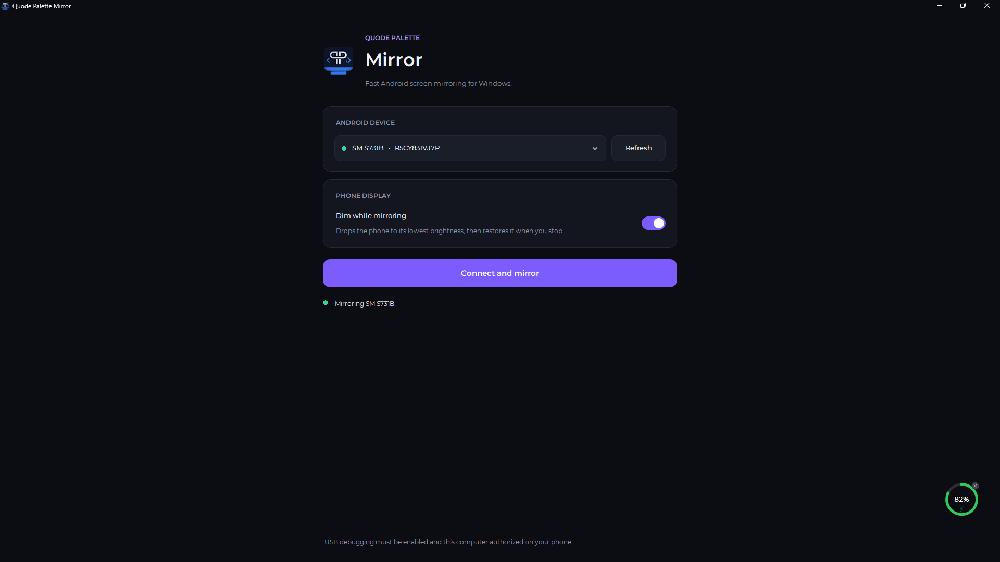
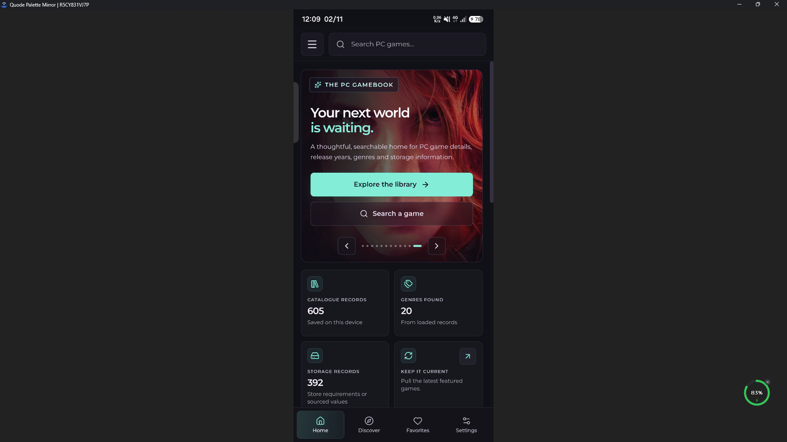
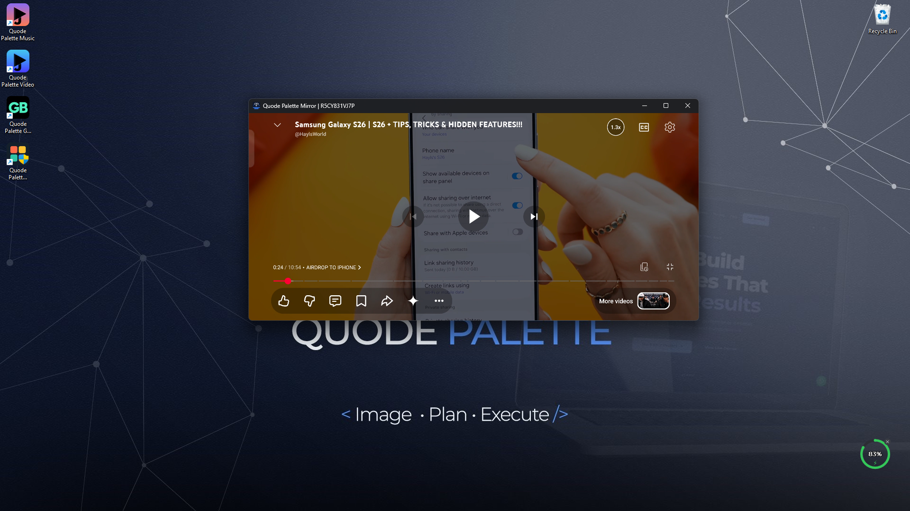

# Quode Palette Mirror

Quode Palette Mirror is a small Python and Tk app that wraps [scrcpy](https://github.com/Genymobile/scrcpy). scrcpy does the heavy lifting (video, input, ADB). This project adds a friendlier front end, phone display controls, and a proper Windows identity for the mirror window.

  
  <b>Screenshot I</b>

<table>
    <td width="50%" align="center">
      
       
      <b>Screenshot II</b>
       
      <!-- Convert common audio formats with FFmpeg -->
    </td>
    <td width="50%" align="center">
      
       
      <b>Screenshot III</b>
       
      <!-- Convert common video formats with FFmpeg -->
    </td>
</table>

## Features

- One click mirroring for any USB debugging phone
- Dims the phone while mirroring and restores brightness afterwards
- Mirror window carries the Quode Palette name and icon in the taskbar
- Controller lives in the system tray when you close it
- Ships as a single EXE with scrcpy and ADB inside, nothing else to install

## Fonts

The font is under the SIL Open Font License.

## License

Released under the [PolyForm Noncommercial License 1.0.0](LICENSE). You are free to use, modify and share it for personal, educational and other noncommercial purposes. For commercial use, please get in touch.
[Email Us](mailto:hello@quodepalette.com)
